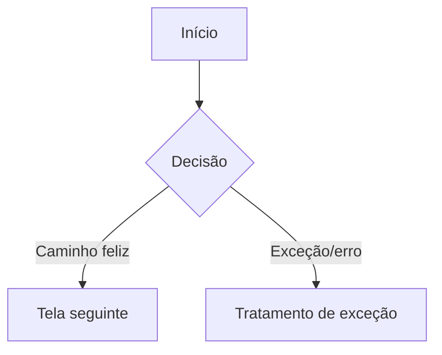

# Prototipação

> As menções a "(regra transversal)" abaixo remetem às regras transversais deste plugin, em `${CLAUDE_SKILL_DIR}/../../docs/REGRAS_TRANSVERSAIS.md` (o arquivo `docs/REGRAS_TRANSVERSAIS.md` na raiz do plugin, não no repositório em que você está trabalhando). Leia esse arquivo antes de aplicar a skill. Fora do Claude Code, as regras precisam ser fornecidas junto com esta skill.

## O princípio inegociável

Nenhum protótipo gerado por IA segue para handoff sem validação e refinamento humano — IA é boa para ideação rápida e primeira versão, não para decisão final de usabilidade. Nenhum protótipo começa sem a identidade visual (skill `identidade-visual`) já reunida e consumida como referência obrigatória — protótipo não inventa estilo próprio à parte do que já está documentado. E nenhuma tela de protótipo é gerada antes do fluxograma macro do fluxo ser aprovado explicitamente — o fluxograma é o gate humano que vem antes da geração, não uma formalidade em paralelo.

## Como conduzir

**0. Verifique o repositório, o framework em uso e a identidade visual antes de prototipar.**
- **Framework em uso (verifique primeiro).** Identifique como o repositório de destino organiza produto e trabalhe no padrão dele (regra transversal — ver `${CLAUDE_SKILL_DIR}/../../docs/REGRAS_TRANSVERSAIS.md`, "Adaptação ao framework em uso"):
  - *O repositório já adota um framework ou estrutura própria* (uma convenção própria de userflow/sitemap, de nomeação de telas, de repositório de protótipo, ou um modelo de avaliação heurística próprio): entregue o fluxograma e o protótipo na convenção que o framework já usa e, se ele tiver um modelo de heurística próprio, use-o no lugar das 5 áreas desta skill.
  - *Nenhum*: use os formatos e o método heurístico desta skill como estão.
  A lógica desta skill — fluxograma aprovado antes de gerar tela, identidade visual como referência obrigatória, evidência real em todo achado, validação humana antes do handoff — continua valendo; o que se adapta é a forma de registrar e o modelo de heurística. Se a convenção do framework conflitar com o formato-padrão daqui, o framework em uso prevalece — sinalize a diferença, não decida sozinha.
- A identidade visual reunida/consolidada na skill `identidade-visual` é pré-requisito, não uma referência opcional — tokens, componentes (com todos os estados) e diretrizes de uso vêm de lá, nunca inventados na hora da geração.
- Se esta skill conflitar com o que já está documentado no repositório, sinalize e pergunte — nunca decida sozinha (regra transversal).

**1. Construa o fluxograma macro do fluxo antes do protótipo em si — nunca só o caminho feliz.**
- Mapeie as telas e a navegação entre elas (de onde vem, para onde vai) num fluxograma macro — visão de hierarquia de informação e decisão, não o detalhe de cada tela — antes de gerar qualquer tela. O protótipo nasce desse fluxograma, não o contrário.
- Se o repositório já tiver um userflow/sitemap ou cenários de uso já mapeados para o mesmo fluxo, reaproveite como base em vez de recriar do zero — só reabra se o usuário pedir para reconsiderar (regra transversal). **Se o ambiente já tiver uma skill dedicada de mapeamento de cenários de uso**, prefira usá-la para essa etapa; na ausência dela, aplique a lógica abaixo diretamente.
- O fluxograma cobre o caminho feliz e os cenários alternativos e de exceção — não pergunte só "o que acontece quando dá certo": pergunte também o que acontece quando o usuário desiste, muda de ideia, erra um dado, ou quando o sistema falha (timeout, erro de integração, indisponibilidade). Um fluxo desenhado só no caminho feliz é entrega incompleta, não um rascunho aceitável.
- Se a exceção mapeada for de natureza operacional "de bastidores" (erro de loja, atraso de entregador, falha de parceiro terceiro, condição externa como trânsito ou ruptura de estoque) — e não algo que a própria tela resolve —, isso é escopo de uma skill dedicada a desvios de processo, se disponível no ambiente; sinalize que esse aprofundamento existe em vez de tentar cobrir a operação inteira só com o fluxograma de tela.
- Considere o volume por caminho, quando o dado existir: quantidade de usuários/acessos que passam por cada ramo do fluxo, se já documentado no repositório ou em dado real fornecido pelo usuário — nunca estime esse número sozinha. Esse volume ajuda a indicar quais ramos merecem mais atenção no protótipo e na validação.
- Situe o fluxo no todo: mapeie como ele se conecta a outras funcionalidades do produto (de onde um usuário chega até este fluxo, para onde ele vai depois) — não desenhe o fluxo como uma ilha isolada.
- Se este protótipo for melhoria de algo que já existe (não um fluxo novo), mapeie explicitamente como ele se conecta ao protótipo/produto existente — parta das telas reais já existentes como ponto de entrada/saída.

**1.1 Aprove o fluxograma macro antes de gerar qualquer tela do protótipo.**
O fluxograma é o gate humano desta etapa — mesma lógica de "IA sugere, uma pessoa aprova" (regra transversal). Apresente o fluxograma (cenários cobertos, volume por caminho, conexões) para revisão explícita do usuário antes de avançar para o passo 2. Se vierem ajustes, atualize o fluxograma e peça aprovação de novo — retrabalho de tela custa mais caro que retrabalho de fluxograma.

**2. Só depois do fluxograma aprovado, aplique boas práticas de prototipação com IA.**
- IA é útil para ideação rápida e protótipos iniciais, mas tende a aplicar padrões genéricos de mercado e pode interpretar mal termos ambíguos do pedido — um exemplo real documentado pela Nielsen Norman Group: pedir uma "página de perfil" gerou um padrão de rede social quando o caso era uma tela orientada a tarefa. Ao gerar, confirme a interpretação do termo com o usuário quando houver ambiguidade.
- Prompts mais longos, detalhados e com referências visuais (a própria identidade visual, exemplos de tela já aprovados) tendem a gerar resultado mais próximo do esperado do que pedidos genéricos.
- IA carece da nuance de um designer experiente em hierarquia visual, espaçamento e contraste — trate a primeira versão gerada como rascunho a refinar, nunca como entrega final.

**3. Nenhum protótipo de IA avança para handoff sem passar por validação humana.**
O protótipo gerado precisa de refinamento e validação humana antes de seguir adiante — nunca é aceito como está, direto da geração.

**4. Rode a análise heurística com o método estruturado abaixo.**
A lógica de pontuação e evidência está descrita por completo aqui — não depende de nenhuma skill externa instalada. **Se o ambiente já tiver uma skill dedicada de avaliação heurística de UX**, prefira usá-la (versão de referência, mais completa e mantida à parte). Na ausência dela, aplique a lógica a seguir diretamente:

- **Evidência real, sempre.** Todo achado citado precisa estar ancorado em algo realmente observado — um screenshot, um frame de vídeo, uma frase transcrita de quem narrou o uso, ou uma medição real de contraste. Nunca invente um problema de usabilidade "genérico" que soaria plausível para o tipo de tela; se não há evidência para uma área numa tela, é legítimo que essa área não tenha achado. Contraste citado em achado de Design/Cores vem de medição real (ex.: APCA), nunca de julgamento visual.
- **5 áreas fixas, 3 critérios cada, por tela avaliada:** Conteúdo, Arquitetura da Informação, Design, Tecnologia, Negócios — 15 avaliações por tela.
- **Pontuação por avaliação:** Importância (0 a 3) × Quebra (Nenhum / Ruído / Obstáculo / Obstrução / Barreira) = Nota. Erro% = Importância × fator de Quebra. Registre a lógica por trás de cada nota — não só o número final.
- **Toda avaliação com Quebra diferente de "Nenhum" cita a base teórica correspondente** (Nielsen, ISO 9241-110, WCAG/APCA, Morville, Miller/Hick, conforme o tipo de achado) — nunca um achado solto sem fundamentação.
- **3 a 5 avaliadores independentes**, que não veem a avaliação um do outro até consolidar os achados — reduz viés de ancoragem. Se só houver 1 avaliador disponível, sinalize essa limitação no resultado.
- **Gate humano antes de qualquer entregável final.** Apresente os achados para aprovação antes de produzir matriz/relatório final formatado.
- **Análise heurística não substitui pesquisa com usuário real** — é complementar ao passo 5, nunca um proxy definitivo.

**5. Valide com usuário real depois da análise heurística.**
Heurística aponta problemas prováveis; validação com usuário real confirma (ou não) que esses problemas afetam quem usa o produto. Não trate a análise heurística como suficiente para aprovar o protótipo sozinha — conecta com as skills `teste-de-usabilidade` e `entrevista-e-pesquisa`.

**6. Registre a decisão e mantenha como contexto.**
- Salve o userflow, o protótipo aprovado e os achados da análise heurística como contexto do repositório (regra transversal).
- O protótipo validado alimenta a skill `handoff-tecnico-e-especificacao` — não avance para especificação técnica com um protótipo ainda não validado.

## Formato da saída

````
## Framework/estrutura em uso
[Framework/estrutura detectada no repositório, ou nenhum — e em que convenção o fluxograma/protótipo e a heurística abaixo foram registrados]

## Conflito com o repositório (se houver)
[O que já está documentado e onde diverge do que esta skill orienta]

## Identidade visual consumida
[Referência usada — tokens, componentes, diretrizes — e se é base provisória a validar]

## Fluxograma macro
[Diagrama do fluxo — telas, decisões, caminho feliz + cenários alternativos/exceção. Ex. em Mermaid:]


**Cenários cobertos:** [caminho feliz + alternativos + exceção — o que veio de cenários já mapeados, e o que foi levantado agora]
**Desvios operacionais "de bastidores" identificados (se houver):** [sinalizados para skill dedicada, se aplicável — não resolvidos aqui]
**Volume por caminho (se houver dado):** [quantidade de usuários/acessos por ramo, com a fonte]
**Conexão com outras funcionalidades:** [de onde o usuário chega, para onde vai depois]
**Conexão com o protótipo/produto existente (se for melhoria):** [telas reais existentes usadas como ponto de entrada/saída]
**Aprovação do fluxograma:** [aprovado por quem, quando]

## Protótipo gerado
[Descrição do que foi gerado; interpretação de termos ambíguos confirmada com o usuário, se houve]

## Análise heurística

### [Nome da tela]
| Área | Critério | Importância (0-3) | Quebra | Nota/Erro% | Base teórica | Evidência |
|---|---|---|---|---|---|---|
| [Conteúdo/AI/Design/Tecnologia/Negócios] | [...] | [...] | [Nenhum/Ruído/Obstáculo/Obstrução/Barreira] | [...] | [Nielsen/ISO 9241-110/WCAG-APCA/Morville/Miller-Hick] | [screenshot/frame/citação/medição] |

Avaliadores: [nomes/papéis — 3 a 5 independentes, ou sinalizar limitação se só houver 1]

## Validação com usuário
[Status — pendente / realizada / achados]

## Pendências
[O que falta para seguir ao handoff técnico]
````

## Cuidados

- Não imponha a convenção de fluxograma/telas nem o modelo heurístico desta skill quando o repositório usa outro framework — use o dele; as exigências (fluxograma aprovado antes da tela, evidência real, validação humana) permanecem, a forma se adapta.
- Não gere protótipo com estilo inventado à parte da identidade visual.
- Não mapeie só o caminho feliz — todo fluxograma cobre também cenários alternativos e de exceção.
- Não estime quantidade de usuários/acessos por caminho sozinha — use dado real, ou deixe em branco.
- Não desenhe o fluxo como uma ilha isolada — mapeie a conexão com outras funcionalidades e, se for melhoria, com o protótipo/produto já existente.
- Não tente resolver desvio operacional "de bastidores" dentro do fluxograma de tela — sinalize para a skill própria disso, se disponível.
- Não comece a gerar telas de protótipo antes do fluxograma macro ser aprovado explicitamente pelo usuário.
- Não trate a primeira versão gerada por IA como entrega final — sempre refinamento e validação humana antes de seguir.
- Não assuma a interpretação mais comum de mercado para um termo ambíguo do pedido — confirme com o usuário.
- Não cite achado de análise heurística sem evidência real — nunca um achado genérico "plausível".
- Não estime contraste visualmente — meça de fato quando o achado for de Design/Cores.
- Não deixe achado com Quebra diferente de "Nenhum" sem citar a base teórica correspondente.
- Não trate a análise heurística como substituta da validação com usuário real.
- Não decida sozinha um conflito entre esta skill e o repositório.
